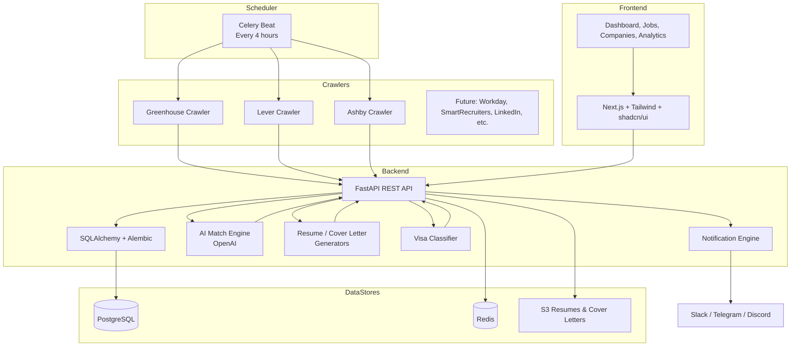

# Architecture

## Component Overview

### Crawler Layer
- Implements a plugin-style architecture with `BaseJobCrawler`.
- Each ATS (Greenhouse, Lever, Ashby) has its own parser.
- Jobs are filtered by target role keywords before storage.

### Deduplication Engine
- Every job posting is hashed with SHA-256.
- Existing jobs are updated rather than duplicated.
- `JobSnapshot` tracks title, description, location, and salary changes.

### AI Layer
- `JobMatcher` sends resume + JD to OpenAI and returns a structured score.
- `ResumeTailor` reorders existing bullets without lying.
- `CoverLetterGenerator` produces tailored 250-word cover letters.
- `VisaClassifier` uses regex heuristics for sponsorship signals.

### API Layer
- FastAPI with `/api/v1` versioning.
- OpenAPI docs auto-generated at `/docs`.
- Async SQLAlchemy sessions for non-blocking I/O.

### Frontend Layer
- Next.js App Router with Tanstack Query for data fetching.
- Sidebar navigation for Dashboard, Jobs, Companies, Analytics, Settings.

### Infrastructure Layer
- AWS ECS Fargate for API and Celery workers.
- RDS PostgreSQL for relational data.
- ElastiCache Redis for Celery broker and caching.
- S3 for resume/cover letter storage.
- CloudFront for frontend static hosting.
- Terraform for infrastructure as code.
